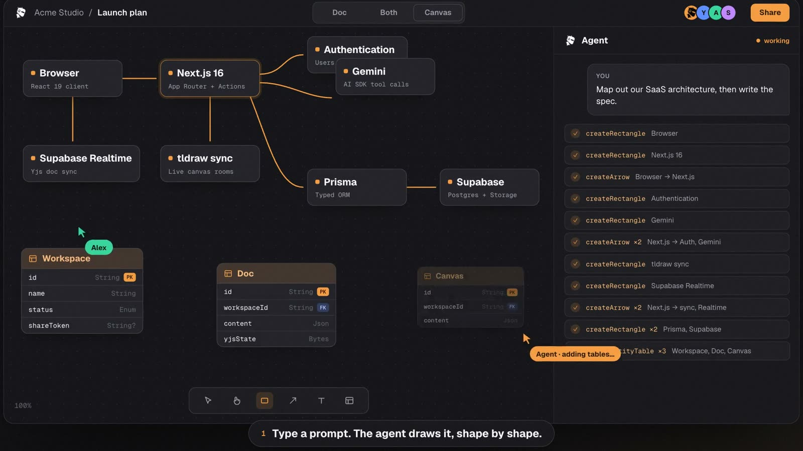
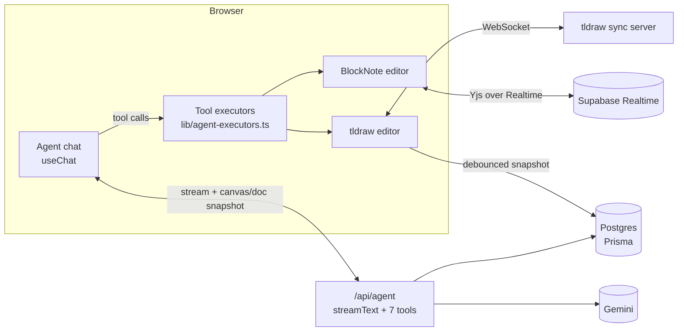

# Outpost

**An AI agent that draws and writes alongside you and your team, live.** Describe a database, a system or a user flow, and the agent draws it on a shared canvas, shape by shape, while drafting the matching doc. Everyone in the workspace sees it happen in real time and can keep editing by hand.

[](https://github.com/Spoorthy0/OutPost/actions/workflows/ci.yml)

**[Live demo](https://YOUR-DEPLOYMENT-URL)** · **[2-minute walkthrough](https://YOUR-LOOM-LINK)**



## What it does

- **Agent-drawn diagrams.** Ask for an ERD, a flowchart, an architecture diagram, a mind map or an org chart. The model picks the structure, a layered layout algorithm places it, and it animates in step by step inside a titled frame.
- **ERD tables with real columns.** A custom tldraw shape with editable columns, primary and foreign keys. Relationship arrows snap to a specific row and stay on that column when columns are added, renamed, reordered or removed.
- **Export the ERD as code.** One click turns the tables on the canvas into PostgreSQL DDL or a Prisma schema, including relation names for multiple and self-relations, composite keys and `@map` for snake_case.
- **A shared doc.** A BlockNote editor where the agent writes specs and notes in markdown, or edits individual blocks by id instead of rewriting the whole doc.
- **One-click undo of an agent run.** A single prompt can run several tools; "Undo canvas changes" reverts all of it in one step, and it can be redone.
- **Real-time collaboration.** Live cursors with names and avatars on the canvas, and a collaborative doc over Yjs.
- **Workspaces, teams and plans.** Personal and organization workspaces, a kanban board of workspaces, read-only share links, PDF export, voice input, and plan limits via Clerk Billing (demo mode).

## Architecture



**The key design decision: tools run in the browser, not on the server.** The tools in [`lib/agent-tools.ts`](lib/agent-tools.ts) have no `execute` function. The model only decides *what* to draw. The client validates the call with Zod and carries it out on the live editors, so the agent's changes flow through exactly the same sync, undo and autosave paths as a person's. Each request sends a compact text listing of the canvas and doc, with ids, so the model can edit what is already there instead of redrawing it.

## Hard problems worth reading

| Problem | Solution | Where |
| --- | --- | --- |
| A new collaborator joining an empty sync room must not overwrite what others drew | The room is the source of truth; Postgres only re-seeds a room that is still empty when the editor mounts | [`CanvasEditor.tsx`](app/(main)/workspace/[id]/_components/CanvasEditor.tsx) |
| Arrows into an ERD table should point at a column, not the table's center, and stay on it as the table changes | Bindings remember a field id in their meta; side-effect handlers re-anchor them when fields change. Fast drags that tldraw anchors to the center use the pointer position instead | [`snapArrowToRow.ts`](components/EntityTable/snapArrowToRow.ts) |
| Readable diagrams from unpositioned nodes | A Sugiyama-style layered layout: DFS back-edge detection for loops, longest-path layering, barycenter ordering to reduce crossings, and size-aware placement | [`canvas-layout.ts`](lib/canvas-layout.ts) |
| The model sends bad tool input | Zod validates every call; a readable list of problems goes back as the tool result and the chat resubmits automatically, so the model fixes its own call | [`agent-executors.ts`](lib/agent-executors.ts) |
| The agent starts drawing before the canvas has connected to sync | Tools wait for the editor, up to 20 s, instead of reporting it closed; each surface has its own queue, so two drawings never pick the same empty spot | [`agent-executors.ts`](lib/agent-executors.ts) |
| A failed model call shouldn't cost a prompt | Prompts are reserved before streaming and refunded exactly once on any failure path; overload (503/429) gets its own message | [`route.ts`](app/api/agent/route.ts) |
| Canvas snapshots failing to cross the Server Action boundary | The snapshot is round-tripped through JSON to strip non-plain internals before saving | [`CanvasEditor.tsx`](app/(main)/workspace/[id]/_components/CanvasEditor.tsx) |

## Tech stack

- **Framework:** Next.js 16 (App Router, Cache Components, Server Actions), React 19, TypeScript
- **Canvas:** tldraw 5 with `@tldraw/sync` and a custom ERD shape
- **Doc:** BlockNote, Yjs, Supabase Realtime
- **AI:** Vercel AI SDK 7 (`streamText`, client-side tool calls) with Google Gemini
- **Data:** PostgreSQL with Prisma 7
- **Auth and billing:** Clerk (users, organizations, Billing)
- **UI:** Tailwind CSS 4, shadcn/ui, Radix
- **Testing:** Vitest with a headless tldraw editor in jsdom, GitHub Actions

## Testing

```bash
npm test          # run once
npm run test:watch
```

The agent's tools are tested against a **real, headless tldraw editor**, not mocks ([`tests/editor.ts`](tests/editor.ts)). The tests run `create_tables`, read the ERD back from the canvas, and check the exported SQL. They also check that relation arrows follow their columns through renames and reorders, and that a whole agent run undoes and redoes in one step. The layout algorithm, the tool schemas and the SQL/Prisma generators have unit tests. Prisma output was also checked with `prisma validate`.

CI runs lint, type-check and tests on every push and pull request, plus a production build when the deploy secrets are set.

## Running locally

Requirements: Node 20.9+, npm 11 (`npm i -g npm@11`), and accounts for Clerk, a Postgres database (e.g. Supabase) and a Gemini API key.

```bash
git clone https://github.com/Spoorthy0/OutPost.git
cd OutPost
npm install
cp .env.example .env      # fill in the values
npx prisma migrate deploy
npm run dev
```

Open http://localhost:3000. On localhost, tldraw works without a license key and uses its public demo sync server unless `NEXT_PUBLIC_TLDRAW_SYNC_URL` is set.

## Project structure

```
app/
  api/agent/route.ts        agent endpoint: auth, prompt quota, streamText with the tools
  (main)/workspace/[id]/    workspace page: canvas, doc, agent chat, sharing
  shared/[token]/           read-only share links
actions/                    Server Actions (workspaces, canvas/doc saves, billing, usage)
components/EntityTable/     ERD shape, row snapping, Add table and Export schema buttons
hooks/                      agent chat (tool execution, undo), collaborative doc
lib/
  agent-tools.ts            tool definitions and Zod input schemas
  agent-executors.ts        runs tool calls on the live editors
  canvas-layout.ts          layered graph layout
  erd-export.ts             ERD → PostgreSQL / Prisma
  supabase-yjs-provider.ts  Yjs sync over Supabase Realtime
prisma/                     schema and migrations
tests/                      test setup and headless editor
```

## Known limitations and next steps

- The doc's Supabase Realtime channel is public. Production would use a private channel with Realtime Authorization (RLS on `realtime.messages`) and the Clerk session token.
- Without a self-hosted sync server, canvas rooms live on tldraw's demo server, which is public and wiped daily. The Postgres snapshot re-seeds them.
- Undo of an agent run covers the canvas; the doc has its own undo history.
- Next: an end-to-end test with Playwright, image-to-diagram, and per-workspace usage charts.

## License

Built as a portfolio project. tldraw is used under its [Hobby license](https://tldraw.dev/pricing).
